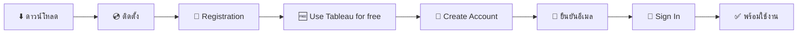
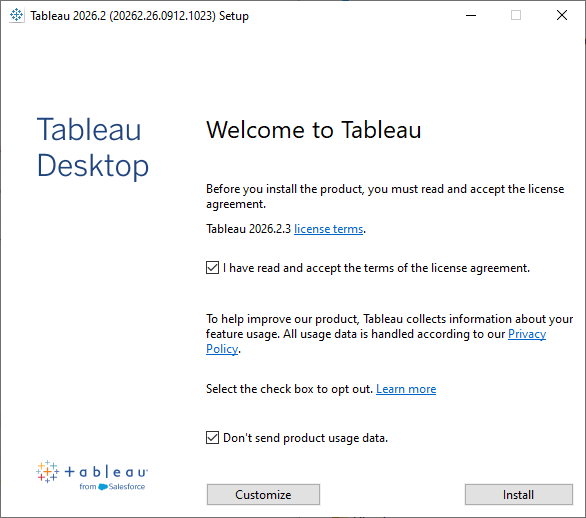
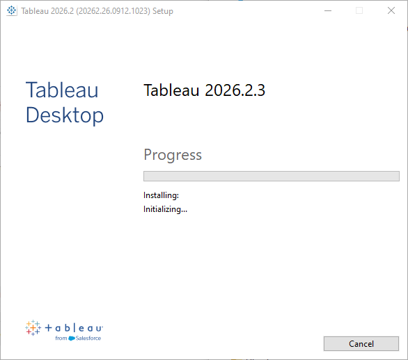
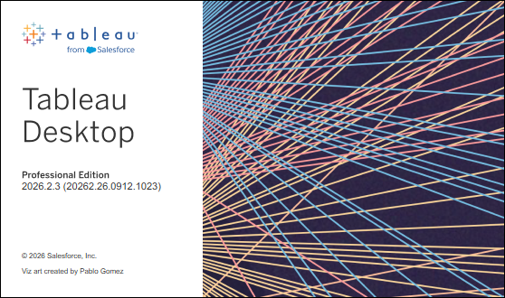
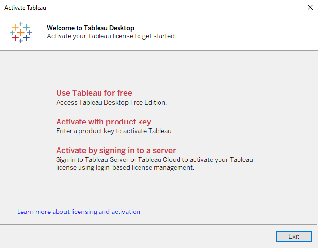
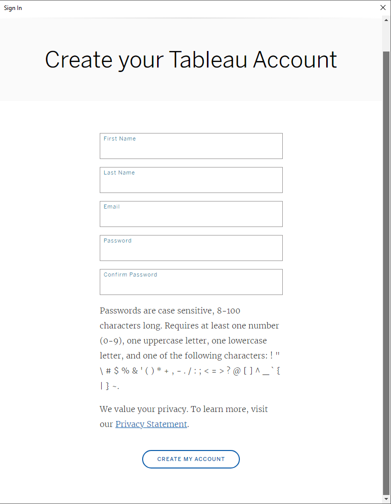
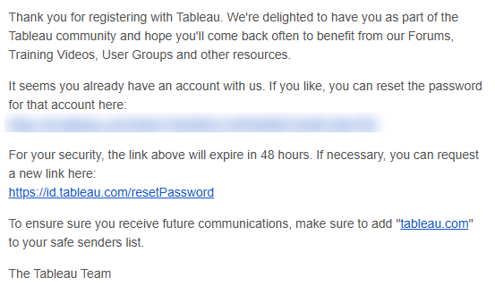
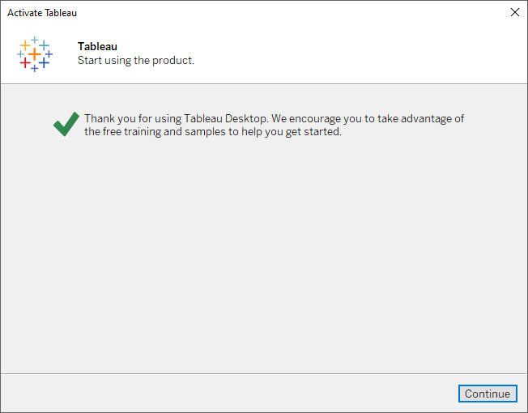
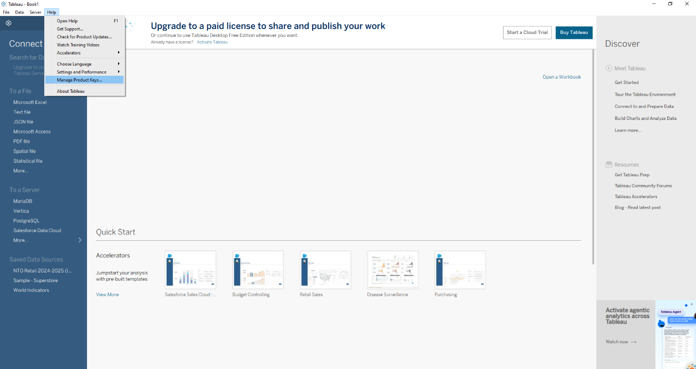

# 📊 คู่มือติดตั้ง Tableau Desktop Free Edition

> ดาวน์โหลด ติดตั้ง สร้าง Tableau Account ด้วยอีเมล และ Activate เป็น **Free Edition** ใช้งานได้ฟรีบนเครื่องตัวเอง

---

## 🧭 สารบัญ

| ขั้นตอน | หัวข้อ |
|:---:|---|
| 0️⃣ | [สิ่งที่ต้องเตรียม](#step-0) |
| 1️⃣ | [ดาวน์โหลดตัวติดตั้ง](#step-1) |
| 2️⃣ | [ติดตั้ง Tableau Desktop](#step-2) |
| 3️⃣ | [ลงทะเบียนผู้ใช้ (Registration)](#step-3) |
| 4️⃣ | [เลือก Use Tableau for free](#step-4) |
| 5️⃣ | [สร้าง Tableau Account ด้วยอีเมล](#step-5) |
| 6️⃣ | [ยืนยันอีเมล](#step-6) |
| 7️⃣ | [Sign In และ Activate สำเร็จ](#step-7) |
| ✅ | [ตรวจสอบว่าเป็น Free Edition](#verify) |
| 📋 | [Free vs Public vs Professional](#compare) |
| 🛠️ | [แก้ปัญหาที่พบบ่อย](#troubleshooting) |

---

## 🗺️ ภาพรวมขั้นตอน

---

## 0️⃣ สิ่งที่ต้องเตรียม

| รายการ | รายละเอียด |
|---|---|
| 💻 เครื่องคอมพิวเตอร์ | Windows 10/11 (64-bit) หรือ macOS |
| 🔑 สิทธิ์ผู้ดูแลเครื่อง | ต้องมีสิทธิ์ Administrator เพื่อติดตั้งโปรแกรม |
| 📧 อีเมลที่ใช้งานได้ | ใช้สร้าง Tableau Account และรับลิงก์ยืนยัน |
| 🌐 อินเทอร์เน็ต | ใช้ทั้งตอนดาวน์โหลดและตอน Activate |

---

## 1️⃣ ดาวน์โหลดตัวติดตั้ง

1. เข้าเว็บไซต์ 👉 **[tableau.com/products/desktop-free/download](https://www.tableau.com/products/desktop-free/download)**
2. กรอกข้อมูลในฟอร์ม (อีเมล ชื่อ บริษัท) แล้วกด **Download**
3. ระบบจะดาวน์โหลดไฟล์ติดตั้ง เช่น `TableauDesktop-64bit-2026-2-3.exe` (Windows) หรือ `.dmg` (macOS)

> [!NOTE]
> ตัวติดตั้งของ Free Edition และ Professional Edition เป็น **ไฟล์ตัวเดียวกัน** สิ่งที่ทำให้เป็น Free Edition คือการเลือก **Use Tableau for free** ตอน Activate (ขั้นตอนที่ 4)
> ถ้าต้องการเวอร์ชันเฉพาะ ดาวน์โหลดได้ที่ [Tableau Desktop Release Notes / All Versions](https://www.tableau.com/support/releases)

---

## 2️⃣ ติดตั้ง Tableau Desktop

1. ดับเบิลคลิกไฟล์ติดตั้งที่ดาวน์โหลดมา
2. ติ๊ก ☑️ **I have read and accept the terms of the license agreement**
3. *(ไม่บังคับ)* ติ๊ก ☑️ **Don't send product usage data** ถ้าไม่ต้องการส่งข้อมูลการใช้งานให้ Tableau
4. กด **Install** *(หรือ **Customize** ถ้าต้องการเปลี่ยนโฟลเดอร์ติดตั้ง)*

5. รอจนติดตั้งเสร็จ (ประมาณ 3–5 นาที)

> [!IMPORTANT]
> ถ้า Windows ถาม **User Account Control (UAC)** ให้กด **Yes** เพื่ออนุญาตการติดตั้ง

---

## 3️⃣ ลงทะเบียนผู้ใช้ (Registration)

เมื่อติดตั้งเสร็จ Tableau Desktop จะเปิดขึ้นมาเอง (หรือเปิดจาก Start Menu)

> [!NOTE]
> หน้า Splash จะแสดงคำว่า **Professional Edition** ตามปกติ ไม่ต้องตกใจ เพราะยังไม่ได้เลือกประเภท License

กรอกข้อมูลในหน้า **Registration** ให้ครบทุกช่อง

| ช่อง | ตัวอย่าง |
|---|---|
| First Name | Somchai |
| Last Name | Demo |
| Organization | Demo Company |
| Email | your.name@company.com |
| Country/Region | Thailand |
| Company Size | 21 – 200 employees |

แล้วกด **Register**

เมื่อขึ้น ✅ **Registration completed.** ให้กด **Continue**

---

## 4️⃣ เลือก Use Tableau for free

หน้า **Activate Tableau** จะมีให้เลือก 3 ทาง

| ตัวเลือก | ใช้เมื่อ |
|---|---|
| 🆓 **Use Tableau for free** | ✅ **เลือกอันนี้** เพื่อใช้ Tableau Desktop Free Edition |
| 🔑 Activate with product key | มี Product Key ที่ซื้อ License แล้ว |
| ☁️ Activate by signing in to a server | องค์กรใช้ Tableau Server / Tableau Cloud แบบ Login-based License |

---

## 5️⃣ สร้าง Tableau Account ด้วยอีเมล

หน้า **Sign In** จะขึ้นมา

- ถ้า **มี Tableau Account อยู่แล้ว** → กรอก Email + Password แล้วกด **SIGN IN** ข้ามไป [ขั้นตอนที่ 7](#step-7) ได้เลย
- ถ้า **ยังไม่มี** → กด **CREATE AN ACCOUNT**

กรอกข้อมูลในหน้า **Create your Tableau Account**

1. First Name
2. Last Name
3. Email
4. Password
5. Confirm Password

แล้วกด **CREATE MY ACCOUNT**

> [!WARNING]
> **เงื่อนไขรหัสผ่าน** (ถ้าไม่ครบจะสร้างบัญชีไม่ได้)
>
> | เงื่อนไข | |
> |---|---|
> | ความยาว | 8–100 ตัวอักษร (ตัวพิมพ์เล็ก-ใหญ่มีผล) |
> | ตัวเลข | อย่างน้อย 1 ตัว (0–9) |
> | ตัวพิมพ์ใหญ่ | อย่างน้อย 1 ตัว (A–Z) |
> | ตัวพิมพ์เล็ก | อย่างน้อย 1 ตัว (a–z) |
> | อักขระพิเศษ | อย่างน้อย 1 ตัว เช่น `! # $ % & * @ ? _ ~` |
>
> ตัวอย่างรหัสที่ผ่าน: `Tableau@2026`

เมื่อสร้างสำเร็จ จะขึ้นข้อความว่าระบบส่งอีเมลยืนยันไปแล้ว

---

## 6️⃣ ยืนยันอีเมล

1. เปิดกล่องจดหมายของอีเมลที่ใช้สมัคร
2. หาอีเมลหัวข้อ **Tableau Software Account Activation** จาก `reghelp@tableau.com`
3. คลิกลิงก์ในอีเมลเพื่อยืนยันบัญชี

> [!CAUTION]
> ลิงก์ในอีเมล **หมดอายุภายใน 48 ชั่วโมง** ถ้าหมดอายุแล้ว ขอลิงก์ใหม่ได้ที่ [id.tableau.com/resetPassword](https://id.tableau.com/resetPassword)

> [!NOTE]
> ถ้าอีเมลนี้ **เคยสมัคร Tableau มาก่อนแล้ว** อีเมลที่ได้จะเขียนว่า *"It seems you already have an account with us"* (ตามภาพด้านบน) แปลว่าไม่ต้องสร้างใหม่ ให้กลับไป **SIGN IN** ด้วยรหัสเดิม หรือกดลิงก์ในอีเมลเพื่อ **ตั้งรหัสผ่านใหม่**

> [!TIP]
> ไม่เจออีเมล? ลองดูในโฟลเดอร์ **Spam / Junk / Promotions** และเพิ่ม `tableau.com` เป็น Safe Sender

---

## 7️⃣ Sign In และ Activate สำเร็จ

1. กลับมาที่ Tableau Desktop หน้า **Sign In**
2. กรอก **Email** และ **Password** ที่เพิ่งสร้าง แล้วกด **SIGN IN**
3. เมื่อขึ้น ✅ *Thank you for using Tableau Desktop...* ให้กด **Continue**

🎉 เข้าสู่หน้า Start Page ของ Tableau Desktop พร้อมใช้งาน

---

## ✅ ตรวจสอบว่าเป็น Free Edition

| จุดสังเกต | ตำแหน่ง |
|---|---|
| แบนเนอร์ **"Upgrade to a paid license to share and publish your work"** และข้อความ *"Or continue to use Tableau Desktop Free Edition whenever you want."* | ด้านบนของ Start Page |
| **Search for Data** เป็นสีเทา พร้อมข้อความ *"Upgrade to connect to Tableau Server"* | แถบ Connect ด้านซ้าย |
| เมนู **Help ▸ Manage Product Keys...** | ใช้ดูสถานะ License หรือใส่ Product Key เมื่ออัปเกรด |

 Manage Product Keys">

> [!TIP]
> ถ้าภายหลังได้ License แบบเสียเงิน ไม่ต้องติดตั้งใหม่ กด **Activate Tableau** ที่แบนเนอร์ด้านบน หรือไปที่ **Help ▸ Manage Product Keys...** แล้วใส่ Product Key ได้เลย

---

## 📋 Free vs Public vs Professional

| ความสามารถ | 🌍 Public Edition | 🆓 Free Edition | 💼 Professional |
|---|:---:|:---:|:---:|
| ค่าใช้จ่าย | ฟรี | ฟรี | เสียเงิน |
| บันทึกไฟล์ลงเครื่อง | ✅ | ✅ | ✅ |
| Data Connectors | จำกัด (Excel, Text, JSON, PDF, Google Drive ฯลฯ) | เกือบครบ *(ยกเว้น Published Data Source บน Server/Cloud)* | ✅ ครบทุกตัว |
| จำนวนแถวข้อมูล | สูงสุด 15 ล้านแถว | ไม่จำกัด | ไม่จำกัด |
| Publish ขึ้น Tableau Public | ✅ | ❌ | ✅ |
| Publish ขึ้น Tableau Server / Cloud | ❌ | ❌ | ✅ |
| แชร์ Packaged Workbook (.twbx) | ❌ | ❌ | ✅ |

> [!IMPORTANT]
> **Free Edition** เหมาะกับการ **เรียนรู้ ทดลอง และวิเคราะห์ข้อมูลบนเครื่องตัวเอง** แต่ถ้าต้องการ **แชร์ / Publish Dashboard** ให้คนอื่นดู ต้องอัปเกรดเป็น Professional (Tableau Creator License)
>
> อ้างอิง: [Tableau Desktop Public, Free and Professional Edition Feature Comparison](https://help.tableau.com/current/pro/desktop/en-us/desktop_comparison.htm)

---

## 🛠️ แก้ปัญหาที่พบบ่อย

| ปัญหา | วิธีแก้ |
|---|---|
| ❌ สร้างบัญชีไม่ผ่าน | ตรวจรหัสผ่านให้ครบเงื่อนไข (ตัวเลข + ตัวพิมพ์ใหญ่ + ตัวพิมพ์เล็ก + อักขระพิเศษ, 8 ตัวขึ้นไป) |
| 📭 ไม่ได้รับอีเมลยืนยัน | ดูใน Spam / Promotions รอ 5–10 นาที หรือขอใหม่ที่ [id.tableau.com/resetPassword](https://id.tableau.com/resetPassword) |
| 🔁 อีเมลแจ้งว่า *"already have an account"* | อีเมลนี้เคยสมัครแล้ว ให้ Sign In ด้วยรหัสเดิม หรือกดลิงก์ในอีเมลเพื่อตั้งรหัสใหม่ |
| ⏰ ลิงก์ในอีเมลใช้ไม่ได้ | ลิงก์หมดอายุ (48 ชม.) ขอลิงก์ใหม่ที่ [id.tableau.com/resetPassword](https://id.tableau.com/resetPassword) |
| 🌐 Sign In แล้วค้าง / Error | ตรวจอินเทอร์เน็ต, Proxy หรือ Firewall ของบริษัท ต้องเข้า `*.tableau.com` ได้ |
| 🔒 ติดตั้งไม่ได้ | ต้องใช้สิทธิ์ Administrator ติดต่อ IT ของบริษัท |

---

## 🔗 ลิงก์ที่เกี่ยวข้อง

- ⬇️ [ดาวน์โหลด Tableau Desktop Free Edition](https://www.tableau.com/products/desktop-free/download)
- 📦 [Tableau Desktop ทุกเวอร์ชัน (Release Notes)](https://www.tableau.com/support/releases)
- 📋 [Feature Comparison: Public / Free / Professional](https://help.tableau.com/current/pro/desktop/en-us/desktop_comparison.htm)
- 🔑 [Tableau ID / Reset Password](https://id.tableau.com/resetPassword)

---

  <a href="#top">⬆️ กลับไปด้านบน</a>

<b>Created by The Narit Lab</b>

